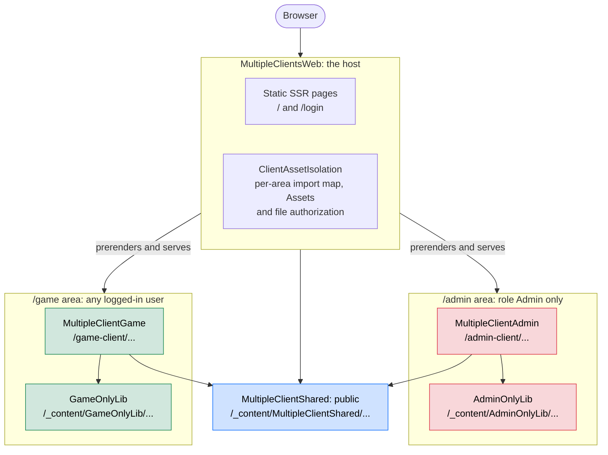

# Multiple WebAssembly clients in one Blazor Web App

A sample of one .NET 10 **Blazor Web App** that serves static SSR pages (home, login) and hosts **several
Interactive WebAssembly clients**, each in its own area of the site. It is an alternative to the older hosted model,
where every area is a standalone WebAssembly app behind a Razor Pages host page and always shows a loading screen.

Each client only reaches the users who may open its area: other users cannot download its assemblies, libraries or
images, and the pages of other areas do not even mention them.

**Live demo:** <https://multiple-clients-blazor.azurewebsites.net> (log in with any user name and pick a role).

```
dotnet run --project MultipleClientsWeb --launch-profile http
dotnet test --solution MultipleClientApps.slnx
```

## Contents

- [Architecture](#architecture)
- [Hosting several clients in one app](#hosting-several-clients-in-one-app)
- [Authentication](#authentication)
- [Keeping each client private](#keeping-each-client-private)
- [Area-only libraries](#area-only-libraries)
- [Static assets and `@Assets`](#static-assets-and-assets)
- [Cache busting](#cache-busting)
- [Caveats](#caveats)
- [Compared with the hosted model](#compared-with-the-hosted-model)

## Architecture



Unlabeled arrows are project references. The host references every project, so it serves all their files, but each
file is owned by at most one area:

| Project | What it is | Pages | Files served from | Who can download them |
| --- | --- | --- | --- | --- |
| `MultipleClientsWeb` | Host: static SSR pages, cookie authentication | `/`, `/login` | `/` | anyone |
| `MultipleClientAdmin` | WebAssembly client | `/admin/**` | `/admin-client/` | role `Admin` |
| `AdminOnlyLib` | Razor class library used only by the admin client | – | `/_content/AdminOnlyLib/` | role `Admin` |
| `MultipleClientGame` | WebAssembly client | `/game/**` | `/game-client/` | any logged-in user |
| `GameOnlyLib` | Razor class library used only by the game client | – | `/_content/GameOnlyLib/` | any logged-in user |
| `MultipleClientShared` | Razor class library used by the host and both clients | – | `/_content/MultipleClientShared/` | anyone |
| `MultipleClientsWeb.Tests` | TUnit request-level tests of the host | – | – | – |

What each page gets:

| Page | WebAssembly runtime | Import map and `@Assets` list | Library CSS linked | Resource collection |
| --- | --- | --- | --- | --- |
| `/`, `/login` | none | host and shared files | shared | none |
| `/admin/**` | `/admin-client/_framework/` | host, shared, admin client, `AdminOnlyLib` | shared, `AdminOnlyLib` | `/admin-client/_framework/resource-collection.{hash}.js` |
| `/game/**` | `/game-client/_framework/` | host, shared, game client, `GameOnlyLib` | shared, `GameOnlyLib` | `/game-client/_framework/resource-collection.{hash}.js` |

## Hosting several clients in one app

There is no official guidance for this setup in .NET 8 to 10 (see dotnet/aspnetcore#52216, dotnet/aspnetcore#62249
and dotnet/aspnetcore#65910, all still open). It copies what the aspnetcore repository does in its own
`Components.TestServer` test assets (`GlobalInteractivityApp.razor`, `RemoteAuthenticationApp.razor`).

- **A separate `StaticWebAssetBasePath` per client.** Both clients publish a `_framework` folder. Without separate
  base paths the SDK fails with *Conflicting assets with the same target path*. With them, the runtimes are served
  from `/admin-client/_framework/` and `/game-client/_framework/`.
- **One `MapRazorComponents<App>()`** with `AddAdditionalAssemblies` for both clients. Client pages are routed by
  their full URL (`@page "/admin/users"`), so there is a single endpoint table and server-side `[Authorize]` works
  unchanged.
- **`App.razor` picks the area by request path** (`ClientArea.FromPath`):
  - outside an area it renders the host's `Routes` as static SSR. `blazor.web.js` only handles enhanced navigation
    there, and no runtime is loaded;
  - inside an area it renders that client's own `Routes` with `@rendermode="InteractiveWebAssembly"`. The page is
    prerendered and then becomes interactive.
- **`Blazor.start({ webAssembly: { loadBootResource } })`** points the runtime loader at the area's base path.
  `blazor.web.js` always asks for `/_framework/dotnet.js`, which does not exist when a client has its own base path.
  The import map from `<ImportMap />` then resolves the fingerprinted file names.
- **A preload of the area's own runtime.** `App.razor` adds a `<link rel="preload">` for the current area's
  `dotnet.js` only, instead of `<ResourcePreloader />` (see [Caveats](#caveats)).

## Authentication

- The host uses cookie authentication with a static SSR login page. An anonymous user who opens an area is
  redirected to it before any WebAssembly is downloaded.
- The authentication state flows from the host to each client through `AddAuthenticationStateSerialization` and
  `AddAuthenticationStateDeserialization`. Each client's router is an `AuthorizeRouteView`.
- `ClientArea.RequiredRole` sets who may download a client's files. Keep it in line with the `[Authorize]`
  attributes of the client's pages.

## Keeping each client private

By default a Blazor Web App puts the files of *all* clients in every page's import map and in one public
`_framework/resource-collection.js`, and anyone can download `/admin-client/_framework/MultipleClientAdmin.wasm`.
The lists reveal which assemblies, and so which features, each client contains. Because the assembly names are
predictable, hiding the lists alone would not be enough. `ClientAssetIsolation` does three things:

1. **Authorize the files.** `MapStaticAssets().RequireClientAreaAuthorization()` puts an `[Authorize]` (with
   `ClientArea.RequiredRole`) on every file an area owns. Without access, the request is redirected to the login page.
2. **Scope each page's asset list.** `MapRazorComponents<App>()...WithClientAreaAssetsOnly()` replaces the app-wide
   asset collection of each page with the host's files, the shared libraries and that page's own area.
   `<ImportMap />` and `@Assets[...]` pick it up without changes.
3. **Give each client its own resource collection.** The WebAssembly client normally imports the app-wide
   `_framework/resource-collection.js` to resolve `@Assets[...]`. `UseNoAppWideResourceCollection` answers that url
   with 404. An area page instead hands its client the url of the area's own collection,
   `/{area}/_framework/resource-collection.{hash}.js`, which `MapClientAreaResourceCollections` serves only to users
   with access to the area.

## Area-only libraries

`AdminOnlyLib` and `GameOnlyLib` show how a Razor class library can belong to one area. An area owns a library when
it is listed in `ClientArea.Libraries`; the steps above then cover its `/_content/{library}/` files and its `.wasm`
under the client's `_framework` folder.

- **JS modules** are imported by their plain path (`./_content/AdminOnlyLib/admin-tools.js`). The page's import map
  maps it to the fingerprinted file, and only pages of the owning area have that entry.
- **Scoped CSS.** The SDK `@import`s the scoped CSS bundle of *every* referenced library into the host's
  `MultipleClientsWeb.styles.css`. The `ExcludeAreaOnlyLibrariesFromHostCssBundle` target in
  `MultipleClientsWeb.csproj` removes the libraries listed as `AreaOnlyLibrary`, and `App.razor` links each library's
  `{library}.bundle.scp.css` only on pages of its own area.
- **The list exists twice**: in `ClientArea.Libraries` (C#) and as `AreaOnlyLibrary` (MSBuild). The test
  `Get_HostCssBundle_LeavesOutAreaOnlyLibraries` fails when they drift apart.
- A library used by both areas must not be listed. It stays public, like `MultipleClientShared`.

## Static assets and `@Assets`

`@Assets["path"]` turns a file's path into its fingerprinted url, using the page's asset list. Thanks to the
per-area resource collection, this works both while prerendering and after the WebAssembly client takes over.

The shared `AssetPicture` component shows it with three sample pictures. It renders the picture, the `@Assets[...]`
call, the resolved url and the renderer that resolved it:

| Page | Pictures |
| --- | --- |
| `/admin` | `admin-client/images/admin-picture.svg` (admin client `wwwroot`) and `_content/MultipleClientShared/images/shared-picture.svg` |
| `/game` | `game-client/images/game-picture.svg` (game client `wwwroot`) and the shared picture |
| `/` | the shared picture only |

The home page also shows that `@Assets["admin-client/images/admin-picture.svg"]` stays unfingerprinted there,
because that file is not in the page's asset list.

## Cache busting

The home page shows the urls each technique below produces. The `VersionBadge` from `MultipleClientShared` uses them
on the SSR pages and in both clients.

| Technique | Where in this sample |
| --- | --- |
| **Fingerprinted urls through `@Assets[...]`.** `MapStaticAssets` serves them with `max-age=31536000, immutable`, except under `_content` and the client folders (last row). | `App.razor`: `app.css`, favicon, `SharedAssets.CssBundle`; `AssetPicture` |
| **A version query on urls that code builds itself** (library code, `import()` of JS modules). | `SharedAssets.AppendVersion`, `SharedAssets.ModuleUrl` |
| **A version query on image `url()`s in scoped CSS**, added after `BundleScopedCssFiles` by the `VersionCssUrls` task in `Directory.Build.targets`. The SDK does not fingerprint `url()`s inside scoped CSS. | `MultipleClientShared.csproj`, `VersionBadge.razor.css` |
| **A fingerprinted `@import` of a library's scoped CSS bundle.** | Done by the .NET 10 SDK, no rewrite needed |
| **The client runtime resolved through the import map.** `dotnet.js` itself stays unfingerprinted and `no-cache`, so the browser always gets the current boot manifest. | `<ImportMap />` + `loadBootResource` in `App.razor` |
| **No shared caches for `_content`, `_framework` and the client folders.** These responses get `private, max-age=86400, must-revalidate`, or `private, no-cache` where the server sent `no-cache`. A CDN never serves an old library file or boot manifest behind an unchanged url, and never caches a file that needs authorization. | `StaticAssetCaching.UsePrivateLibraryAndFrameworkCaching` |

`$(Version)` is set in `Directory.Build.props`; CI sets it per deployment so every version query changes.

Response headers of a published build (`ASPNETCORE_ENVIRONMENT=Production`; in Development `MapStaticAssets`
sends `no-cache` for everything):

| Url | Cache-Control |
| --- | --- |
| `/app.{hash}.css`, `/MultipleClientsWeb.{hash}.styles.css` | `max-age=31536000, immutable` |
| `/_content/MultipleClientShared/shared.{hash}.css`, `/_framework/blazor.web.{hash}.js` | `private, max-age=86400, must-revalidate` |
| `/_content/MultipleClientShared/images/logo.svg?v=1.0.0` | `private, max-age=86400, must-revalidate` |
| `/_content/MultipleClientShared/js/asset-info.js?v=1.0.0`, `/admin-client/_framework/dotnet.js` | `private, no-cache` |

## Caveats

**Navigation**

- **One WebAssembly runtime per page.** `Blazor.start` can only run once, so moving from one area to another, or
  from SSR into an area, must be a full page load:
  - on SSR pages, put `data-enhance-nav="false"` on links into an area;
  - inside a client, use `NavigateTo(..., forceLoad: true)`;
  - after the login post, redirect with `forceLoad: true`.
- **Client routes must not overlap**, because there is a single endpoint table. Prefixing every page with its area
  handles this.

**Assets**

- **Don't use `<ResourcePreloader />`.** It preloads the runtime of *every* referenced client on every page.
- **JS initializers (`*.lib.module.js`) of all clients stay public.** `blazor.web.js` loads the initializers of every
  client on every page, including the static SSR pages. In this sample they only exist in Development (the hot reload
  module), and the `Blazor-Web-Initializers` comment lists them there.
- **`_content/*` from Razor class libraries stays at the site root** (dotnet/aspnetcore#62249), not under a client's
  base path. With `<base href="/">` this works without url rewrites for `/<area>/_content/...`.
- **Hot reload of the clients is not verified.** dotnet/aspnetcore#62249 reports that it needs a rewrite of
  `/{client}/_content/Microsoft.DotNet.HotReload.WebAssembly.Browser/*`.

**Framework internals: recheck when you upgrade .NET**

- `ClientAssetIsolation` uses public APIs except for two internal metadata types: it removes
  `ResourcePreloadCollection` by name, and replaces `ResourceCollectionUrlMetadata` with its own instance, created
  through reflection. If that type is renamed, the app fails at startup.
- The `ExcludeAreaOnlyLibrariesFromHostCssBundle` target hooks into internal SDK items (`_ScopedCssProjectBundles`).

## Compared with the hosted model

The hosted model has one standalone WebAssembly app per area (e.g. an admin app with base path `admin`), each behind
a Razor Pages host page:

| | Hosted model | This sample |
| --- | --- | --- |
| Host page | Razor Pages `MapFallbackToPage("admin/{*path}")` | `MapRazorComponents<App>`, one route per page |
| First paint | Loading spinner until WebAssembly runs | Prerendered HTML, then interactive |
| Login | Razor Pages | Static SSR Razor component |
| Boot script | `blazor.webassembly.js` + manual fingerprint map in `loadBootResource` | `blazor.web.js` + import map, `loadBootResource` only swaps the folder |
| Asset paths | Url rewrites for `/<area>/_content/...`, a hand-built `ResourceAssetCollection` | None needed so far |
